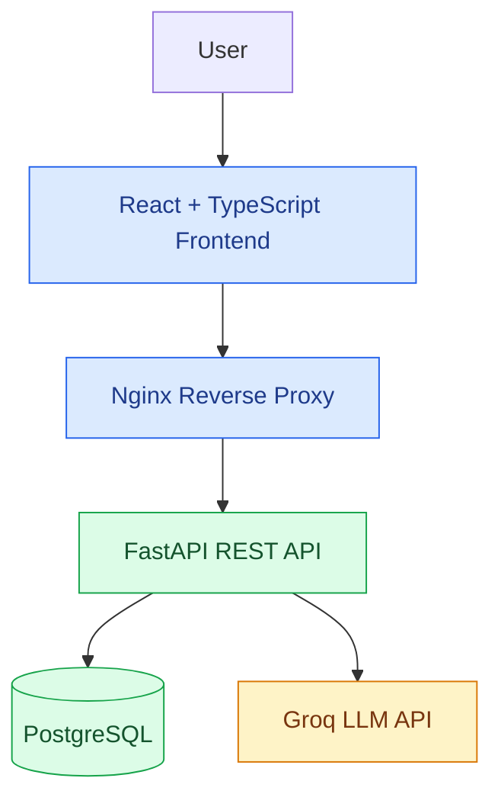

# 💸 AI Expense Agent

An AI-powered personal finance app for tracking expenses, managing budgets, analyzing spending, and chatting with an AI assistant.

<p align="center">
  <a href="https://ai-expense-agent-6b1v.onrender.com/"><strong>🚀 Live Demo</strong></a> •
  <a href="https://ai-expense-agent-api.onrender.com/docs"><strong>📚 API Docs</strong></a> •
  <a href="https://github.com/Aarzoosagar/ai-expense-agent"><strong>💻 Source Code</strong></a>
</p>

---

## Overview

AI Expense Agent pairs a React frontend with a FastAPI backend, a PostgreSQL database, and a Groq-hosted LLM. It is built around three goals:

- **Track:** record and organize everyday expenses and transactions.
- **Understand:** explore spending through dashboards and analytics.
- **Assist:** ask finance questions through an AI chat interface.

## Features

- **Authentication:** user registration and login
- **Expenses and transactions:** add, view, edit, and delete records
- **Budgets:** create and manage budgets
- **Dashboard and analytics:** overview of activity, spending data, and trends
- **AI assistant:** chat powered by the Groq API
- **Settings:** application preferences
- **Responsive UI:** React, Vite, and Tailwind CSS
- **REST API:** FastAPI with interactive Swagger docs
- **Persistence:** PostgreSQL
- **Deployment:** Docker, with Nginx serving the frontend

## Tech Stack

| Layer | Technology |
|---|---|
| Frontend | React, TypeScript, Vite, Tailwind CSS |
| Backend | Python, FastAPI |
| Database | PostgreSQL |
| AI | Groq API |
| Serving | Nginx |
| Packaging and hosting | Docker, Render |

## Architecture



**How a request flows:** the browser calls the React app, which sends `/api/` requests through Nginx to FastAPI. FastAPI reads and writes PostgreSQL and, for chat features, calls the Groq API before returning the response.

## Project Structure

```text
ai-expense-agent/
├── backend/
│   ├── app/
│   │   └── main.py
│   ├── Dockerfile
│   └── requirements.txt
├── frontend/
│   ├── public/
│   ├── src/
│   ├── Dockerfile
│   ├── nginx.conf
│   ├── package.json
│   └── vite.config.ts
└── README.md
```

This is a high-level view; the repository may contain additional modules and config files.

## Live Deployment

| Component | URL |
|---|---|
| Frontend | https://ai-expense-agent-6b1v.onrender.com/ |
| Backend API | https://ai-expense-agent-api.onrender.com/ |
| Health check | https://ai-expense-agent-api.onrender.com/api/health |
| Swagger UI | https://ai-expense-agent-api.onrender.com/docs |

> On Render's free tier, services may take a short while to wake up on the first request.

## Getting Started

### Prerequisites

- Python 3.12+
- Node.js 22+
- PostgreSQL
- Git
- A [Groq API key](https://console.groq.com/)

### 1. Clone the repository

```bash
git clone https://github.com/Aarzoosagar/ai-expense-agent.git
cd ai-expense-agent
```

### 2. Run the backend

```bash
cd backend
python -m venv .venv
```

Activate the virtual environment:

```bash
# macOS / Linux
source .venv/bin/activate
```

```powershell
# Windows PowerShell
.\.venv\Scripts\Activate.ps1
```

Install dependencies:

```bash
pip install -r requirements.txt
```

Create a `.env` file in `backend/`:

```env
DATABASE_URL=your_postgresql_connection_string
LLM_PROVIDER=groq
GROQ_API_KEY=your_groq_api_key
GROQ_MODEL=openai/gpt-oss-20b
SECRET_KEY=your_strong_random_secret
```

> **Never commit `.env` or any API keys, database passwords, or secrets.**

Start the server:

```bash
uvicorn app.main:app --reload
```

The API runs at `http://127.0.0.1:8000`, with docs at `http://127.0.0.1:8000/docs`.

### 3. Run the frontend

In a second terminal:

```bash
cd frontend
npm ci
npm run dev
```

Open the URL Vite prints. For local development, make sure the frontend's API requests point to your local backend.

## Docker and Production Deployment

Both services include a Dockerfile. The frontend uses a multi-stage build: it compiles the React app, then serves the static files through Nginx, which proxies `/api/` requests to the FastAPI backend. The backend container runs Uvicorn on port `8000`.

To deploy on Render:

1. Set the backend environment variables and the PostgreSQL connection URL.
2. Deploy the backend service.
3. Deploy the frontend service with `frontend` as the build root and `Dockerfile` as the Dockerfile path.
4. Point the Nginx proxy at the backend's HTTPS hostname, with TLS server-name indication (SNI) enabled.
5. Run through the testing checklist below against the deployed services.

## Security Notes

- Keep API keys and database credentials in environment variables only.
- Use strong, unique secrets and serve production traffic over HTTPS.
- Validate incoming requests on the backend and enforce authentication on protected routes.
- Avoid logging passwords, tokens, or other sensitive data.

## Testing Checklist

Before a release, verify that:

- [ ] The health endpoint returns success and reports database connectivity
- [ ] Registration and login work, and protected routes require authentication
- [ ] Expenses can be created, edited, and deleted
- [ ] Budgets persist correctly
- [ ] Dashboard and analytics show the expected data
- [ ] AI chat returns valid responses
- [ ] Invalid input and API failures are handled gracefully
- [ ] The UI works on desktop and mobile

## Roadmap

- Automated spending categorization
- Budget alerts and overspending notifications
- Natural-language expense entry
- Recurring expense detection
- Personalized spending insights
- Report export
- Automated tests and CI/CD
- Observability and error monitoring

## What This Project Demonstrates

- Full-stack architecture with React, TypeScript, and FastAPI
- Relational database integration with PostgreSQL
- LLM API integration with Groq
- Docker packaging and Nginx reverse proxying
- Cloud deployment, environment management, and debugging production networking and TLS issues

## Author

**Aarzoo Sagar** — [@Aarzoosagar](https://github.com/Aarzoosagar)

---

<p align="center"><strong>Built to explore the intersection of AI and personal finance.</strong></p>
